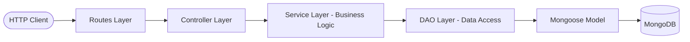

# Notes API - CI/CD Pipeline Example

A RESTful Notes API built with **Node.js**, **Express**, and **MongoDB (Mongoose)**, following clean layered architecture (Controller &rarr; Service &rarr; DAO &rarr; Model) with automated testing via **Jest** and **Supertest** (using in-memory MongoDB), and a complete **GitHub Actions CI/CD** pipeline deploying to **Render**.

---

## Table of Contents

- [Architecture Overview](#architecture-overview)
- [Key Features](#key-features)
- [Project Directory Structure](#project-directory-structure)
- [Prerequisites](#prerequisites)
- [Installation & Local Setup](#installation--local-setup)
- [Environment Variables](#environment-variables)
- [Running the Application](#running-the-application)
- [Running Tests](#running-tests)
- [API Endpoints Reference](#api-endpoints-reference)
- [CI/CD Pipeline Workflow](#cicd-pipeline-workflow)
  - [Pipeline Breakdown](#pipeline-breakdown)
  - [Configuring Render Deployment](#configuring-render-deployment)

---

## Architecture Overview

The application follows the **Separation of Concerns** principle by organizing code into distinct layers:



- **Server (`app/server.js`)**: Connects to the database and starts listening on the configured port.
- **App Factory (`app/app.js`)**: Factory function creating the Express app, attaching middleware (JSON parser, Morgan logger), registering routes, and centralizing error/404 handling. Enables clean dependency injection for unit and integration testing.
- **Routes (`app/routes/notes.routes.js`)**: Defines API endpoints and maps them to controller methods.
- **Controllers (`app/controllers/notes.controller.js`)**: Handles HTTP requests, extracts parameters/body, delegates to the service layer, and returns HTTP responses with appropriate status codes.
- **Service (`app/service/notes.service.js`)**: Implements business logic and payload validation (e.g., required fields, 400 Bad Request, 404 Not Found).
- **DAO (`app/dao/notes.dao.js`)**: Data Access Object abstracting database queries away from the business layer.
- **Model (`app/models/node.model.js`)**: Mongoose schema and model definition with automatic timestamps.
- **Config (`app/config/db.js`)**: MongoDB connection management.

---

## Key Features

- **Full CRUD operations** for notes (Create, Read all, Read by ID, Update, Delete).
- **Layered Architecture**: Clean separation between routing, business logic, and database access.
- **Dependency Injection**: Express app factory allows custom service and DAO injection for testing.
- **Centralized Error Handling**: Uniform error responses across all endpoints.
- **Health Check Endpoint**: `/health` endpoint for uptime monitoring and deployment probes.
- **Automated Integration Testing**: Comprehensive test suite running against an in-memory MongoDB instance (`mongodb-memory-server`).
- **CI/CD Automation**: GitHub Actions pipeline that automatically tests every push to `main` and deploys passing builds to Render.

---

## Project Directory Structure

```text
.
├── .github/
│   └── workflows/
│       └── cicd.yml              # GitHub Actions CI/CD workflow configuration
├── app/
│   ├── config/
│   │   └── db.js                 # MongoDB connection logic
│   ├── controllers/
│   │   └── notes.controller.js   # HTTP request & response handlers
│   ├── dao/
│   │   └── notes.dao.js          # Data Access Object for MongoDB operations
│   ├── models/
│   │   └── node.model.js         # Mongoose schema and model for Notes
│   ├── routes/
│   │   └── notes.routes.js       # Express route definitions
│   ├── service/
│   │   └── notes.service.js      # Business logic & validation layer
│   ├── app.js                    # Express application factory & middleware
│   └── server.js                 # Server entry point
├── test/
│   └── notes.test.js             # Integration tests (Supertest + Jest)
├── .env.example                  # Environment variables template
├── .gitignore                    # Git ignore file
├── package.json                  # Dependencies and scripts
└── README.md                     # Project documentation
```

---

## Prerequisites

- **Node.js**: `v20.x` or higher
- **npm**: `v10.x` or higher
- **MongoDB**: Local MongoDB instance (`mongodb://127.0.0.1:27017`) or MongoDB Atlas connection URI

---

## Installation & Local Setup

1. **Clone the repository:**
   ```bash
   git clone <repository-url>
   cd Practice_Projects
   ```

2. **Install dependencies:**
   ```bash
   npm install
   ```

3. **Configure environment variables:**
   Copy the `.env.example` file to create a `.env` file:
   ```bash
   cp .env.example .env
   ```

---

## Environment Variables

| Variable    | Default Value                           | Description                                     |
|-------------|-----------------------------------------|-------------------------------------------------|
| `PORT`      | `3000`                                  | The port number the Express server listens on   |
| `MONGO_URI` | `mongodb://127.0.0.1:27017/notes_app`   | MongoDB connection string (local or cloud Atlas)|
| `NODE_ENV`  | `development`                           | Execution environment mode                      |

---

## Running the Application

### Start the Server:
```bash
npm start
```

The server will connect to MongoDB and start on the designated port:
```text
Server running on port 3000
```

---

## Running Tests

Tests run using **Jest**, **Supertest**, and **mongodb-memory-server** (an ephemeral in-memory database that doesn't affect your local database).

```bash
npm test
```

### Test Coverage Includes:
- `GET /health` &rarr; Checks server health status.
- `POST /api/notes` &rarr; Creates a note with title and content.
- `GET /api/notes` &rarr; Retrieves the list of notes.
- `GET /api/notes/:id` &rarr; Validates 404 response for non-existent IDs.
- `PUT /api/notes/:id` &rarr; Updates note content or title.
- `DELETE /api/notes/:id` &rarr; Deletes a note and returns confirmation.

---

## API Endpoints Reference

Base URL: `http://localhost:3000`

### 1. Health Check
- **Endpoint:** `GET /health`
- **Description:** Verifies service availability.
- **Response:** `200 OK`
  ```json
  {
    "status": "ok"
  }
  ```

---

### 2. Create a Note
- **Endpoint:** `POST /api/notes`
- **Description:** Adds a new note to the database.
- **Request Headers:** `Content-Type: application/json`
- **Request Body:**
  ```json
  {
    "title": "Grocery List",
    "content": "Milk, eggs, bread, coffee"
  }
  ```
- **Response:** `201 Created`
  ```json
  {
    "_id": "67b848c41234567890abcdef",
    "title": "Grocery List",
    "content": "Milk, eggs, bread, coffee",
    "createdAt": "2026-02-21T13:00:00.000Z",
    "updatedAt": "2026-02-21T13:00:00.000Z"
  }
  ```

---

### 3. Get All Notes
- **Endpoint:** `GET /api/notes`
- **Description:** Retrieves all notes sorted by latest first.
- **Response:** `200 OK`
  ```json
  [
    {
      "_id": "67b848c41234567890abcdef",
      "title": "Grocery List",
      "content": "Milk, eggs, bread, coffee",
      "createdAt": "2026-02-21T13:00:00.000Z",
      "updatedAt": "2026-02-21T13:00:00.000Z"
    }
  ]
  ```

---

### 4. Get Note by ID
- **Endpoint:** `GET /api/notes/:id`
- **Description:** Fetches a single note matching the given ID.
- **Response (Success):** `200 OK`
  ```json
  {
    "_id": "67b848c41234567890abcdef",
    "title": "Grocery List",
    "content": "Milk, eggs, bread, coffee",
    "createdAt": "2026-02-21T13:00:00.000Z",
    "updatedAt": "2026-02-21T13:00:00.000Z"
  }
  ```
- **Response (Not Found):** `404 Not Found`
  ```json
  {
    "message": "note not found"
  }
  ```

---

### 5. Update a Note
- **Endpoint:** `PUT /api/notes/:id`
- **Description:** Updates the title and/or content of an existing note.
- **Request Body (Partial or Full):**
  ```json
  {
    "title": "Updated Grocery List"
  }
  ```
- **Response:** `200 OK`
  ```json
  {
    "_id": "67b848c41234567890abcdef",
    "title": "Updated Grocery List",
    "content": "Milk, eggs, bread, coffee",
    "createdAt": "2026-02-21T13:00:00.000Z",
    "updatedAt": "2026-02-21T13:05:00.000Z"
  }
  ```

---

### 6. Delete a Note
- **Endpoint:** `DELETE /api/notes/:id`
- **Description:** Deletes a note by its ID.
- **Response:** `200 OK`
  ```json
  {
    "message": "note deleted successfully"
  }
  ```

---

## CI/CD Pipeline Workflow

The repository includes an automated CI/CD pipeline defined in [`.github/workflows/cicd.yml`](.github/workflows/cicd.yml).

### Pipeline Stages

```text
[ Push to main ]
       │
       ▼
┌──────────────┐
│   test job   │  1. Checkout repository
│ (CI Gate)    │  2. Setup Node.js 20 with npm caching
└──────┬───────┘  3. Run npm install & npm test
       │ (On Success)
       ▼
┌──────────────┐
│  deploy job  │  Triggers Render Deploy Webhook
│ (CD Stage)   │  using ${{ secrets.RENDER_DEPLOY_HOOK }}
└──────────────┘
```

1. **Trigger**:
   - Triggers automatically whenever a commit is pushed or a PR is merged into the `main` branch.
2. **`test` Job (Continuous Integration)**:
   - Spawns a clean `ubuntu-latest` runner.
   - Checks out the latest code via `actions/checkout@v4`.
   - Configures Node.js 20 with npm dependency caching via `actions/setup-node@v4`.
   - Runs `npm install` to install project dependencies.
   - Executes `npm test` against the automated test suite.
3. **`deploy` Job (Continuous Deployment)**:
   - Specifies `needs: test` as a quality gate &mdash; deployment is aborted if any test fails.
   - Sends an HTTP POST request to Render's Deploy Hook URL using `curl`.

### Configuring Render Deployment

To enable automated deployment:
1. Create a Web Service on [Render](https://render.com) linked to this repository.
2. In the Render service dashboard, navigate to **Settings** &rarr; **Deploy Hook**.
3. Copy the generated **Deploy Hook URL**.
4. In your GitHub repository:
   - Go to **Settings** &rarr; **Secrets and variables** &rarr; **Actions**.
   - Click **New repository secret**.
   - Name: `RENDER_DEPLOY_HOOK`
   - Value: Paste the Deploy Hook URL copied from Render.
5. Pushing new changes to `main` will now automatically test and deploy your application.
